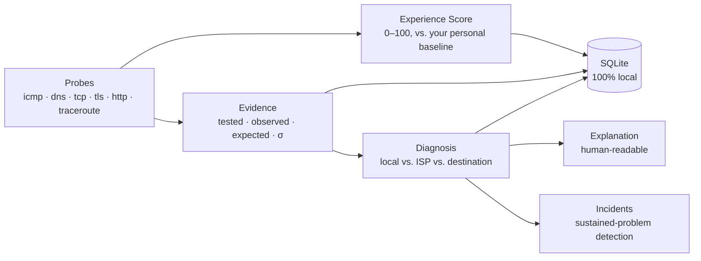

# NetScope

**Internet Experience Intelligence & Network Diagnostics — from raw measurements to "what's wrong, and where", with evidence.**

[](https://github.com/your-username/netscope/actions/workflows/ci.yml)
[](https://github.com/your-username/netscope)
[](LICENSE)
[](https://github.com/astral-sh/ruff)
[](#development)

NetScope doesn't just show you a latency number — it tells you whether the problem is **your Wi-Fi/router**, **your ISP**, or **the destination service**, and shows you the evidence chain behind that claim.



## Why NetScope is different

| | Classic tools (ping / Zabbix-style) | NetScope |
|---|---|---|
| Thresholds | Fixed, global ("alert if > 100 ms") | **Learned per user, per target** (Welford online statistics) |
| Verdict | A number or a boolean | **Evidence-based classification** with confidence and ruled-out list |
| "Missing data" | Silently treated as healthy | A first-class **untested** state — never a fabricated verdict |
| Incidents | One bad sample alerts | Only **sustained** deviations (3+ consecutive rounds) open an incident |
| Storage | Cloud dashboards | **Local-first SQLite** — no data leaves your machine |

The untested-evidence principle is NetScope's core honesty rule: *"missing" is never reported as "healthy"* — a gateway that wasn't probed blocks confident upstream attribution instead of silently enabling it.

## Install

```bash
# Core CLI (rich terminal output)
pip install netscope

# With the live TUI dashboard
pip install "netscope[tui]"

# From source
git clone https://github.com/your-username/netscope
cd netscope && pip install -e ".[tui,dev]"
```

> **Windows note:** ICMP works out of the box. On **Linux/macOS**, raw-socket permission is optional — NetScope automatically falls back to unprivileged UDP ping; for the most reliable ICMP results use `sudo` or set the socket capability (`sudo setcap cap_net_raw+ep $(which python)`).

## Quickstart

```bash
netscope                # diagnose (gateway auto-detected) — the default command
netscope tui            # live terminal dashboard
```

### The dashboard


### The CLI


### Route intelligence


## Commands

| Command | What it does |
|---|---|
| `netscope diagnose` | One measurement round (gateway / public DNS / DNS lookup / CDN), experience score, evidence-based diagnosis |
| `netscope check <host> [--checks icmp,dns,tcp,tls,http]` | Probe any target with any subset of checks and score it |
| `netscope route <target> [--no-resolve]` | Traceroute with reverse-DNS hostnames, AS numbers (see below) and route-stability analysis |
| `netscope history [--limit N]` | Recent measurement rounds from the local log |
| `netscope monitor [--interval S] [--rounds N]` | Continuous rounds with sustained-problem incident detection |
| `netscope tui` | The live dashboard (requires `[tui]` extra) |

Every read command accepts `--json` for machine-readable output:

```bash
netscope diagnose --json | jq '.experience'
```

```json
{
  "tool": "netscope",
  "report": "diagnose",
  "experience": {"score": 91.0, "level": "good"},
  "diagnosis": null,
  "measurements": [
    {"probe_type": "icmp", "target": "1.1.1.1", "success": true, "latency_ms": 8.4, "...": "..."}
  ]
}
```

### Gateway localization, automatically

`netscope diagnose` probes your **default gateway** by default (`--gateway auto`) — detected from the OS (Linux `/proc/net/route`, macOS `route -n get default`, Windows `route print`) with no configuration. That's what lets the diagnosis separate "your Wi-Fi/router" from "your ISP":

```bash
netscope diagnose --gateway 192.168.1.1   # pin it explicitly
netscope diagnose --gateway none          # skip the gateway check
```

### ASN enrichment (optional, offline, license-clean)

Drop any `prefix<TAB>ASN` text database at `~/.netscope/ipasn.dat` (e.g. a routeviews export) and `netscope route` annotates every hop with its AS number — pure-Python longest-prefix-match, zero network calls. Without the file, routes simply render without AS numbers. See [`docs/architecture/adr-011`](docs/architecture) for the format.

### Personal baseline that actually learns

Every successful measurement feeds a per-target Welford tracker (mean + variance, exact round-trips) persisted in `~/.netscope/netscope.db`. After a few rounds NetScope knows *your* normal — 100 ms is a regression for fibre and unremarkable for a mobile hotspot — and scores/diagnoses deviations statistically (σ-based), never against a hardcoded constant.

```bash
netscope history   # watch the baseline mature round over round
```

### Monitoring with honest incident detection

```bash
netscope monitor --interval 30
```

A problem must be sustained for **3 consecutive rounds** to *open* an incident, and a sustained-healthy stretch to *close* one. Single noisy samples never flap incident state, and sustained *"not enough evidence"* rounds neither open nor close anything.

## Configuration (optional)

`~/.netscope/config.toml` — every field has a built-in default; NetScope runs with zero configuration:

```toml
gateway = "192.168.1.1"          # default for --gateway
public_dns_target = "1.1.1.1"    # ICMP target standing in for "the internet"
dns_lookup_domain = "example.com"
public_cdn_url = "https://www.cloudflare.com/"
```

## Architecture

Hexagonal (ports & adapters), enforced by AST-based tests — `core` imports nothing but the standard library; `app` is the only layer allowed to touch both a port and a concrete adapter; `ui` only talks to `app`.

```
src/netscope/
├── core/          # domain: models, scoring, diagnosis, incidents, routing, baseline (pure, offline-testable)
├── adapters/      # probes (icmp/dns/tcp/tls/http/traceroute), discovery, ASN lookups
├── persistence/   # SQLite repositories (measurements, baseline) + versioned schema
├── app/           # use cases, config, composition root, reports, monitoring session
└── ui/            # rich CLI + Textual TUI
```

Deep-dive documents live in [`docs/architecture/`](docs/architecture): architecture overview, module boundaries, data flow, and 10+ ADRs — including the evidence/hypothesis diagnosis design and the untested-evidence principle.

## Privacy

**100% local-first.** Measurements, baselines and history live in `~/.netscope/netscope.db`. Nothing is uploaded, ever — the only network traffic NetScope generates is the probes themselves.

## Development

```bash
make install    # editable install + dev tools
make test       # 525+ tests, fully offline (fake probes, no network needed)
make lint       # ruff check + format check
make typecheck  # mypy on the package
```

The test suite is **fully offline** — every probe is a scripted fake, including the TUI tests (driven through Textual's pilot). New probe types plug in via `ProbeRegistry.register()` without touching core.

## Roadmap

See [`docs/architecture/future-roadmap.md`](docs/architecture/future-roadmap.md). Done recently (v0.2): baseline persistence, gateway auto-detection, `--json` everywhere, `check`/`history`/`monitor` commands, ASN enrichment, TUI dashboard, CI + tooling. Next: per-service configs persisted, route history + churn over time, GeoIP distance estimation, packet-loss-triggered extra rounds.

## License

MIT — see [`LICENSE`](LICENSE). Third-party licenses are documented in [`NOTICE`](NOTICE) (notably the LGPL-3.0 attribution for `icmplib`, used unmodified via dynamic import).
