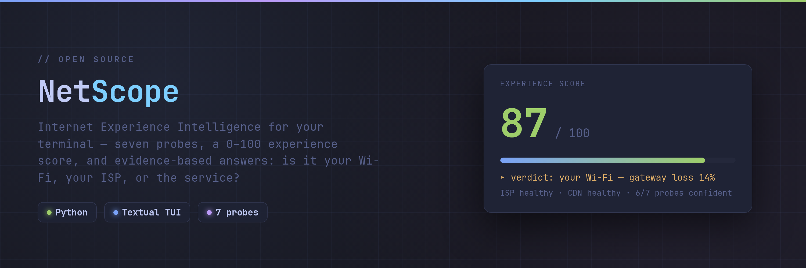
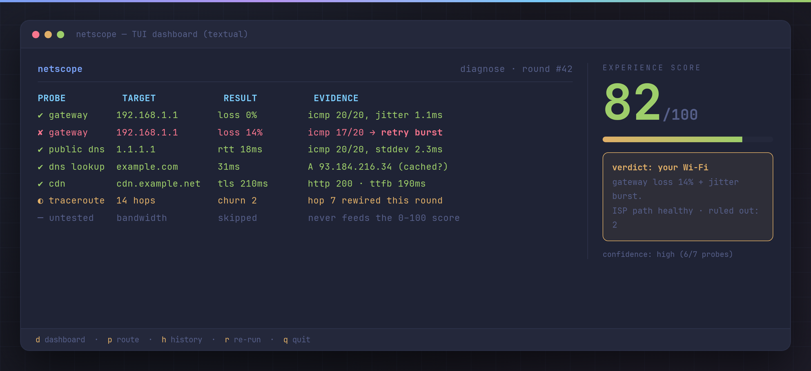
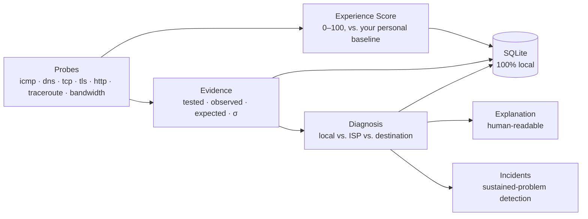
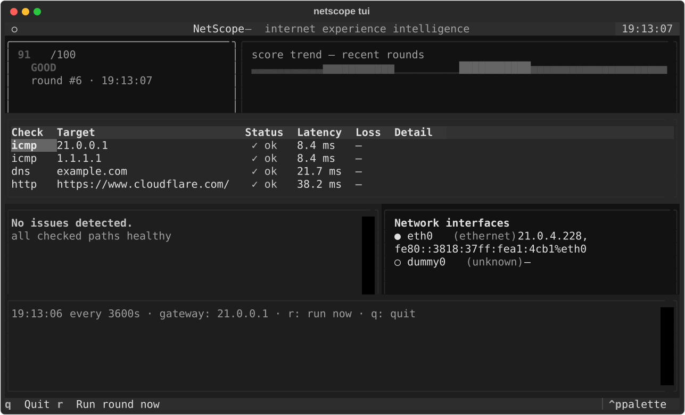
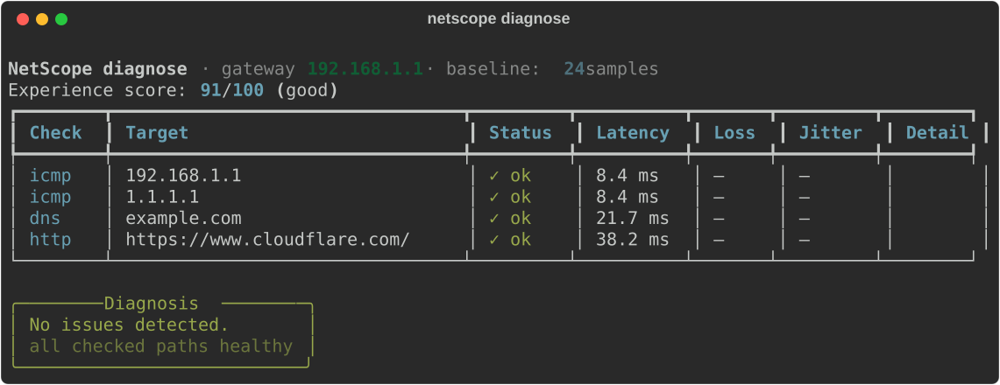
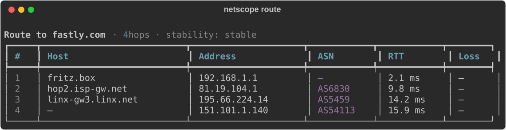
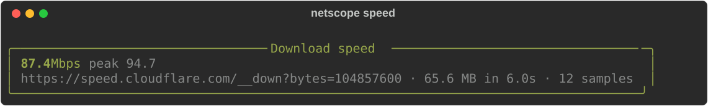

# NetScope

<p align="center"></p>

**Internet Experience Intelligence & Network Diagnostics — from raw measurements to "what's wrong, and where", with evidence.**

[](https://github.com/Abolfazlrwm/netscope/actions/workflows/ci.yml)
[](https://github.com/Abolfazlrwm/netscope)
[](LICENSE)
[](https://github.com/astral-sh/ruff)

<p align="center"></p>
[](#development)

NetScope doesn't just show you a latency number — it tells you whether the problem is **your Wi-Fi/router**, **your ISP**, or **the destination service**, and shows you the evidence chain behind that claim.



## Why NetScope is different

| | Classic tools (ping / Zabbix-style) | NetScope |
|---|---|---|
| Thresholds | Fixed, global ("alert if > 100 ms") | **Learned per user, per target** (Welford online statistics) |
| Verdict | A number or a boolean | **Evidence-based classification** with confidence and ruled-out list |
| "Missing data" | Silently treated as healthy | A first-class **untested** state — never a fabricated verdict |
| Incidents | One bad sample alerts | Only **sustained** deviations (3+ consecutive rounds) open an incident |
| Storage | Cloud dashboards | **Local-first SQLite** — no data leaves your machine |

The untested-evidence principle is NetScope's core honesty rule: *"missing" is never reported as "healthy"* — a gateway that wasn't probed blocks confident upstream attribution instead of silently enabling it.

## Install

```bash
# Core CLI (rich terminal output)
pip install netscope

# With the live TUI dashboard
pip install "netscope[tui]"

# From source
git clone https://github.com/Abolfazlrwm/netscope
cd netscope && pip install -e ".[tui,dev]"
```

> **Windows note:** ICMP works out of the box. On **Linux/macOS**, raw-socket permission is optional — NetScope automatically falls back to unprivileged UDP ping; for the most reliable ICMP results use `sudo` or set the socket capability (`sudo setcap cap_net_raw+ep $(which python)`).

## Quickstart

```bash
netscope                # diagnose (gateway auto-detected) — the default command
netscope --version      # confirm what you're running
netscope tui            # live terminal dashboard
netscope speed          # download throughput, judged against your usual
```

### The dashboard



The TUI is six screens under one shell (v0.6) — all sharing one round pipeline, one incident session, one log:

| Key | Screen | What it shows |
|---|---|---|
| `d` | Dashboard | Live score, trend, per-probe results, diagnosis, incidents |
| `n` | Network | Interfaces, their types/addresses, the detected gateway |
| `p` | Route | Traceroute with hostname/ASN/organization/country enrichment and the cross-run churn verdict |
| `e` | Evidence | The full evidence table, ruled-out list, plain-language explanation |
| `h` | History | Recent rounds from the local log, with per-round detail |
| `s` | Services | Status board of every measured target + on-demand host checks |

### The CLI



### Route intelligence



### Download speed

```bash
netscope speed                    # 6-second window, endpoint from config
netscope speed --seconds 10       # longer window, steadier median
netscope speed --url <any-url>    # measure against a different endpoint
```



Streams the endpoint for a bounded window, samples Mbps at fixed
intervals, and reports the **median** sample (robust against the TCP
slow-start ramp), with the peak and bytes moved as evidence. It is a
standalone command on purpose — a speed test is slow and data-hungry,
so it never runs inside `diagnose` rounds, and its result is evidence
only: it does not feed the 0–100 score.

Since v0.4, every successful run is also learned into a **personal
throughput baseline** (its own store, its own table — never the
latency/loss metrics a download must not pose as). Once the baseline
has a few runs behind it, each new test is judged against your usual:
±15% counts as *as usual*, beyond that you get *slower/faster than
usual* — in the panel and in `--json` (`baseline_mean_mbps`,
`baseline_samples`, `deviation_pct`, `verdict`). The first runs only
learn; NetScope stays silent until it has something honest to say. The
endpoint and window are configurable via the `bandwidth_url` /
`bandwidth_seconds` config keys.

### Evidence reports

```bash
netscope report                                   # last 7 days, every target
netscope report --days 30 --target api.example.com  # one target, one month
netscope report --days 7 --out week.md            # a file to attach to the ticket
```

Rebuilds the persisted measurement log into one self-contained
markdown document: the window's rounds with recomputed scores,
per-target evidence tables, every failure with its error taxonomy, and
the notes that keep the numbers honest. Disclosure over truncation:
tables show the newest 40 rows per target and state exactly how many
older rows were omitted — the aggregates always cover the full window.

## Commands

| Command | What it does |
|---|---|
| `netscope diagnose` | One measurement round (gateway / public DNS / DNS lookup / CDN), experience score, evidence-based diagnosis |
| `netscope check <host> [--checks icmp,dns,tcp,tls,http]` | Probe any target with any subset of checks and score it |
| `netscope service add/list/remove/check` | Your curated service list, persisted locally: save, list, remove, and run a saved service's own checks (v0.7) |
| `netscope route <target> [--no-resolve]` | Traceroute with reverse-DNS hostnames, AS numbers (see below) and route-stability analysis **across your stored history** — "unchanged across the last N runs" / "changed vs <date>: hop K: old → new" (v0.8) |
| `netscope history [--limit N]` | Recent measurement rounds from the local log |
| `netscope monitor [--interval S] [--rounds N]` | Continuous rounds with sustained-problem incident detection |
| `netscope speed [--url URL] [--seconds S]` | Download throughput: median Mbps, peak sample, bytes moved (v0.3) |
| `netscope report [--days N] [--target T] [--out FILE] [--html FILE]` | Export the log as a self-contained evidence report — markdown, or a dark HTML page with inline SVG trends (v0.5; HTML v0.10) |
| `netscope completions bash\|zsh\|fish` | Print a ready-to-install shell completion script, verbatim (v0.11) |
| `netscope tui` | The six-screen live dashboard (requires `[tui]` extra) |

Every read command accepts `--json` for machine-readable output:

```bash
netscope diagnose --json | jq '.experience'
```

```json
{
  "tool": "netscope",
  "report": "diagnose",
  "experience": {"score": 91.0, "level": "good"},
  "diagnosis": null,
  "measurements": [
    {"probe_type": "icmp", "target": "1.1.1.1", "success": true, "latency_ms": 8.4, "...": "..."}
  ]
}
```

### Shell completions and a man page

Tab completion ships inside the package — three hand-written scripts (bash, zsh, fish), no third-party generator, no runtime TAB lag:

```bash
netscope completions bash > ~/.local/share/bash-completion/completions/netscope
netscope completions zsh  > ~/.zfunc/_netscope    # then: fpath=(~/.zfunc $fpath) before compinit
netscope completions fish > ~/.config/fish/completions/netscope.fish
```

`docs/netscope.1` is a man page rendered from the live argparse parser (`make man`) — it cannot drift from the CLI because it *is* the CLI, read back:

```bash
man docs/netscope.1
```

### Gateway localization, automatically

`netscope diagnose` probes your **default gateway** by default (`--gateway auto`) — detected from the OS (Linux `/proc/net/route`, macOS `route -n get default`, Windows `route print`) with no configuration. That's what lets the diagnosis separate "your Wi-Fi/router" from "your ISP":

```bash
netscope diagnose --gateway 192.168.1.1   # pin it explicitly
netscope diagnose --gateway none          # skip the gateway check
```

### Network ownership: ASN + organization (optional, offline, license-clean)

Two offline sources, one enrichment (`adr-013`). The rich one: download GeoLite2-ASN (same free MaxMind account, [`docs/usage/geoip.md`](docs/usage/geoip.md)) and drop `GeoLite2-ASN.mmdb` at `~/.netscope/GeoLite2-ASN.mmdb` — `netscope route`'s Network column then names the operator on every hop (`AS13335 Cloudflare, Inc.`), through the same hand-written `.mmdb` reader the City edition uses, zero new dependencies. The fallback: the v0.2 `prefix<TAB>ASN` text table at `~/.netscope/ipasn.dat` (e.g. a routeviews export) still works — pure-Python longest-prefix-match, number-only, honestly without a name. With neither file, routes simply render without ownership. A corrupt mmdb falls through to the text table, never to a crash.

### Geo location and distance (optional, offline, v0.12)

Download GeoLite2-City (free MaxMind account, your own license key — setup in [`docs/usage/geoip.md`](docs/usage/geoip.md)), drop `GeoLite2-City.mmdb` at `~/.netscope/GeoLite2-City.mmdb`, optionally set `home_ip` (or home coordinates) in `config.toml`, and every check answers *where it is* and *how far away*: `check`/`diagnose` show place, distance and database age in the detail column (and `extra.geo` in `--json`), `route` gains a per-hop Country column, and the evidence report — markdown and `--html` — gains a Geography and ownership section. The `.mmdb` reader is hand-written against the public spec (`adr-011`): zero new dependencies, zero compilation, GeoLite2 never shipped or fetched. A database older than 30 days says so, per the EULA's refresh rhythm.

### Personal baseline that actually learns

Every successful measurement feeds a per-target Welford tracker (mean + variance, exact round-trips) persisted in `~/.netscope/netscope.db`. After a few rounds NetScope knows *your* normal — 100 ms is a regression for fibre and unremarkable for a mobile hotspot — and scores/diagnoses deviations statistically (σ-based), never against a hardcoded constant. Since v0.13 the same treatment covers **jitter**: a fast, lossless line that wobbles now scores — and diagnoses — like what it is, a wobbly line, not like a steady one.

```bash
netscope history   # watch the baseline mature round over round
```

### Monitoring with honest incident detection

```bash
netscope monitor --interval 30
```

A problem must be sustained for **3 consecutive rounds** to *open* an incident, and a sustained-healthy stretch to *close* one. Single noisy samples never flap incident state, and sustained *"not enough evidence"* rounds neither open nor close anything.

## Configuration (optional)

`~/.netscope/config.toml` — every field has a built-in default; NetScope runs with zero configuration:

```toml
gateway = "192.168.1.1"          # default for --gateway
public_dns_target = "1.1.1.1"    # ICMP target standing in for "the internet"
dns_lookup_domain = "example.com"
public_cdn_url = "https://www.cloudflare.com/"
```

## Architecture

Hexagonal (ports & adapters), enforced by AST-based tests — `core` imports nothing but the standard library; `app` is the only layer allowed to touch both a port and a concrete adapter; `ui` only talks to `app`.

```
src/netscope/
├── core/          # domain: models, scoring, diagnosis, incidents, routing, baseline (pure, offline-testable)
├── adapters/      # probes (icmp/dns/tcp/tls/http/traceroute/bandwidth), discovery, ASN lookups
├── persistence/   # SQLite repositories (measurements, baseline) + versioned schema
├── app/           # use cases, config, composition root, reports, monitoring session
└── ui/            # rich CLI + Textual TUI
```

Deep-dive documents live in [`docs/architecture/`](docs/architecture): architecture overview, module boundaries, data flow, and 10+ ADRs — including the evidence/hypothesis diagnosis design and the untested-evidence principle. User-facing docs (install, commands, configuration, JSON output) live in [`docs/usage/`](docs/usage/index.md).

## Privacy

**100% local-first.** Measurements, baselines and history live in `~/.netscope/netscope.db`. Nothing is uploaded, ever — the only network traffic NetScope generates is the probes themselves.

## Development

```bash
make install    # editable install + dev tools
make test       # 890 tests, fully offline (fake probes, no network needed)
make lint       # ruff check + format check
make typecheck  # mypy on the package
```

The test suite is **fully offline** — every probe is a scripted fake, including the TUI tests (driven through Textual's pilot). New probe types plug in via `ProbeRegistry.register()` without touching core.

## Roadmap

See [`docs/architecture/future-roadmap.md`](docs/architecture/future-roadmap.md). Done recently: (v0.5) evidence-report export (`netscope report`) and user-facing usage docs; (v0.6) the full multi-screen TUI — dashboard, network, route, evidence, history and services screens under one shell; (v0.7) the saved service list — `netscope service add/list/remove/check`, persisted locally (schema v3), pinned on the TUI services board; (v0.8) route memory — churn verdicts across your stored route history with hop-level diffs; (v0.11) shell-level plumbing — `--version`, shell completions, a generated man page; (v0.12) GeoIP distance — the dependency-free GeoLite2 reader, place/distance in every read path (TASK-023, the roadmap's last route-model promise); (v0.13) jitter — the third vital sign learned per target, weighed in the 0–100 score, cited as diagnosis evidence, shown in the dashboard and the evidence tables; (v0.14) ownership — GeoLite2-ASN through the same reader, organization names on every route hop and in every report (`adr-013`).

## License

MIT — see [`LICENSE`](LICENSE). Third-party licenses are documented in [`NOTICE`](NOTICE) (notably the LGPL-3.0 attribution for `icmplib`, used unmodified via dynamic import).
